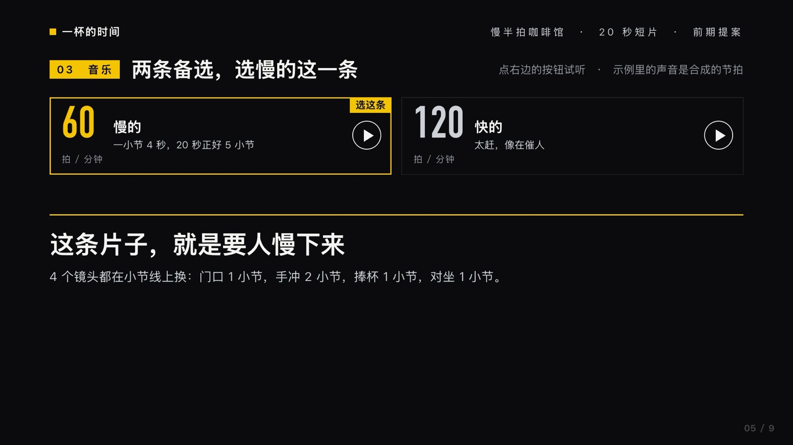
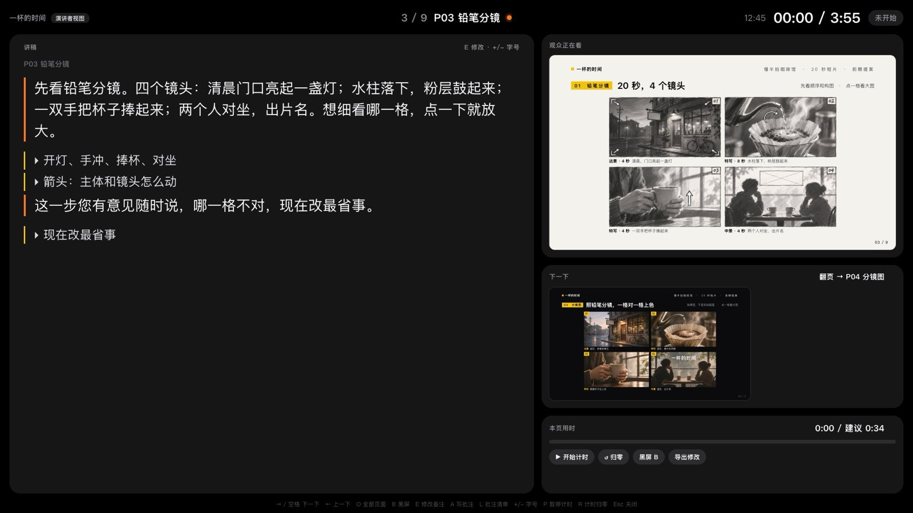

# pitch-deck

让 AI 帮你做提案和汇报：一个双击就能放映的网页，大屏给对方看，自己这边另开一屏看要说的话和手卡。


这是一个**技能**（SKILL.md），不绑定哪一家 AI 工具：装进支持技能的工具，或者直接把这个仓库的链接发给你的 AI。

## 是什么

你告诉 AI 要给谁看、要他定什么、手里有什么材料，它做出一个文件夹，里面的 `index.html` 双击就能放映，不用装软件，不用联网。

- **它是网页，不是 PDF**：图点一下放大；备选的音乐点开就能听；分镜能配着音乐预演一遍。
- **两块屏**：鼠标动一下，左下角出来一条工具条，点「演讲者视图」，另开一个窗口留在自己电脑上；原来那个窗口投到大屏。翻哪边都行，两边同步。
- **每一页都有讲稿**：要说的话（口语、短），加几条 `▸` 要点当手卡。
- **把过程做出来**：片子还没拍、东西还没做的时候，对方看不见结果。调研、色调、故事线、铅笔分镜、分镜图、音乐、转场、预演、封面、发出去的样子，一块一块摆给他看。
- **图一步接一步出**：铅笔分镜画好，把它交回去上色，一格对一格，全片是一套。图让 AI 的出图功能直接生成，不拿代码画。
- **边放边改**：放映时按 A 记一句意见，导出来交给 AI 照着改。

两种骨架：

- 视觉前期提案（片子还没拍、活动还没办、东西还没做）：16 屏，按材料删
- 一般汇报（事情做了，讲结果、要支持）：结论 → 过程 → 效果 → 下一步

## 长什么样

下面是自带的示例：一家虚构的咖啡馆，要拍一条 20 秒的短片。图都是 AI 的出图功能生成的。

| 铅笔分镜 | 把铅笔稿交回去上色 |
|---|---|
|  |  |
| **音乐：点开就能听** | **预演：分镜配上音乐放一遍** |
|  |  |
| **发出去的样子** | **演讲者那一屏** |
|  |  |

想自己翻一遍：把仓库拉下来，用 Chrome 打开 `example/咖啡馆短片提案/index.html`。

## 怎么装

**最省事**：把这个仓库的链接发给你的 AI（比如 Codex），说一句：

> 把这个仓库装成技能：https://github.com/xiaopu-ai/pitch-deck

**手动装**：把仓库拉下来，整个文件夹放进你的 AI 工具放技能的目录。各家目录不一样，看它的说明。比如：

```bash
git clone https://github.com/xiaopu-ai/pitch-deck ~/.codex/skills/pitch-deck
```

**工具不支持技能也行**：拉到任意位置，让你的 AI 先读里面的 `SKILL.md`，照着做。

需要电脑上有 Python 3（macOS 自带）和 Chrome。要出图，你的 AI 工具得有出图功能；没有的话，图位会留着占位，告诉你缺哪几张。

## 怎么用

对你的 AI 说一句话就行，比如：

> 用 pitch-deck 帮我做一份提案：给店主看一条 30 秒短片的前期想法，片子还没拍，素材在这个文件夹里，讲 5 分钟，看完要他定片名和音乐。

或者：

> 用 pitch-deck 做一份汇报：上个月的活动做完了，给老板讲 10 分钟，材料在这个文件夹里，最后要他批下个月的预算。

它会先问你几个问题（给谁看、要定什么、有什么材料、讲多久），列出每一页放什么让你确认，然后一页一页做。

## 怎么打开演讲者那一屏

1. 用 Chrome 打开 `index.html`，这是给观众看的那一屏。
2. 鼠标动一下，左下角出来一条工具条，点「演讲者视图」（或者按 **S**），弹出一个新窗口。把它留在自己的电脑屏幕上。
3. 把原来那个窗口拖到投影或大屏上，按 **F** 全屏。
4. 翻页按 → 或空格，在哪个窗口按都行。

线上开会：只共享观众那个窗口，演讲者那一屏留给自己看。

## 能点的

| 点哪里 | 做什么 |
|---|---|
| 任何一张图 | 放大看，再点一下收起 |
| 音乐卡片上的按钮 | 试听，再点一下停 |
| 预演那一屏的画面 | 分镜配着音乐放一遍；点下面的镜头，从那里放 |
| 空白处 | 下一步 |

## 快捷键

| 键 | 做什么 |
|---|---|
| → / 空格 | 下一步 |
| ← | 上一步 |
| S | 打开演讲者那一屏 |
| F | 全屏 |
| O | 看全部页面 |
| B | 黑屏 / 恢复 |
| A | 记一条批注（可以在画面上拖框） |
| L | 批注清单，复制或下载 |

演讲者那一屏里：P 开始 / 暂停计时，R 计时归零，+ / − 调字号，E 现场改备注。

## 常见问题

**点了「演讲者视图」没反应，或者提示弹窗被拦了**
浏览器第一次会拦弹出的窗口。在地址栏右边点那个被拦截的小图标，选「始终允许」，再点一次。

**只有一块屏幕，能用吗**
能放映，但演讲者那一屏没地方放。要同时看手卡，需要外接一块屏（投影、电视、显示器都行），并且在系统的显示设置里用「扩展」而不是「镜像」：镜像时两块屏是同一个画面。

**两边不同步**
演讲者那一屏要从观众屏打开，不要自己另开一个窗口输网址；两个窗口要在同一台电脑的同一个浏览器里。

**图上要不要标「效果预览」**
默认不标。AI 生成的图来源都记在项目的 `tools/配图提示词.md` 里，你自己随时说得清哪张是哪来的。想在图上标出来：让 AI 在 `index.html` 的 `<div id="stage">` 上加 `class="tags"`。生成的软件界面、数据看板这类图，对方容易当成真的，用之前想清楚。

**想换颜色、换字体**
默认是黑、白、黄。颜色和字体都在 `assets/deck.css` 最上面的变量里，让 AI 改那几行。

**想发给对方自己看**
把整个文件夹打包发过去，对方解压后用 Chrome 打开 `index.html`。讲稿也在里面；不想让对方看到讲稿，让 AI 先把讲稿清掉再打包。

## 文件夹里有什么

| 路径 | 是什么 |
|---|---|
| `SKILL.md` | 给 AI 看的完整流程 |
| `scripts/` `skeletons/` `template/` `engine/` | 建项目的脚本、两种骨架、项目的底子、放映引擎 |
| `references/` | 两种骨架每页放什么、页型怎么写、出图的规矩和提示词 |
| `example/咖啡馆短片提案/` | 完整示例：带讲稿、带声音，交给出图工具的原话也在里面 |

## 许可

MIT
